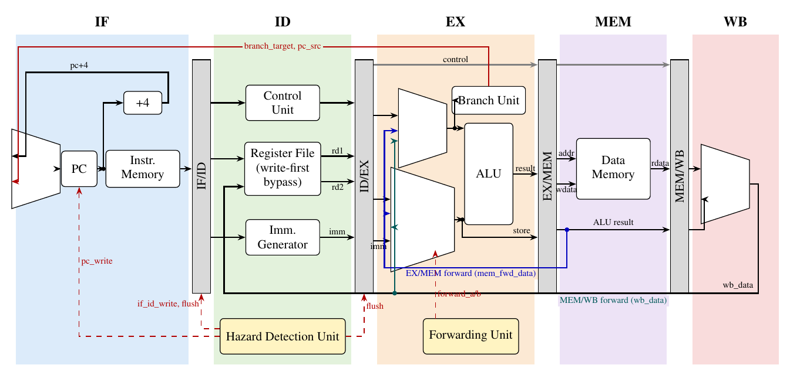

# 5-Stage Pipelined RISC-V Processor

[](rtl/)
[](https://steveicarus.github.io/iverilog/)
[](report/main.pdf)

MCA project (Phase I): design, implementation and verification of a 32-bit **5-stage pipelined
RISC-V processor** supporting a subset of the **RV32I** base integer instruction set, written in
Verilog HDL and simulated with Icarus Verilog and GTKWave.

---

## Project Idea

A single-cycle processor finishes one instruction completely before starting the next. A pipelined
processor splits execution into five stages and overlaps them like an assembly line, so up to five
instructions are in flight at once and throughput approaches one instruction per clock cycle.

```
Clock Cycle:   1     2     3     4     5     6     7
Instruction 1: [IF]  [ID]  [EX]  [MEM] [WB]
Instruction 2:       [IF]  [ID]  [EX]  [MEM] [WB]
Instruction 3:             [IF]  [ID]  [EX]  [MEM] [WB]
Instruction 4:                   [IF]  [ID]  [EX]  [MEM] [WB]
Instruction 5:                         [IF]  [ID]  [EX]  [MEM] [WB]
```

Overlapping instructions creates **hazards**. This design resolves them with:

- **Forwarding unit** – passes results from the EX/MEM and MEM/WB registers straight to the ALU inputs.
- **Hazard detection unit** – stalls one cycle for a load-use dependency and flushes wrongly fetched
  instructions when a branch or jump is taken.
- **Register-file bypass** – a value written in WB is visible to the instruction being decoded in the same cycle.

---

## Project Team

| Roll Number | Name | Part |
|:---:|:---|:---|
| 2401010020 | Abhishek Kumar Patel | Project lead: repository setup, shared definitions (`defines.vh`), IF stage (PC, instruction memory, IF/ID register), top-level integration, IEEE report |
| 2401010519 | Yogesh Modi | ID stage: register file, immediate generator, main control unit, ID/EX register; literature review |
| 2401010210 | Kapish Rohilla | EX stage: ALU, ALU control, branch unit, EX stage with forwarding multiplexers, EX/MEM register |
| 2401010503 | Vikash Kumar | MEM/WB stages and hazards: data memory, MEM/WB register, forwarding unit, hazard detection unit |
| 2401020048 | Prateek Shakya | Verification (system testbench, test programs, run script), diagram sketches, demo video |

---

## Processor Architecture

| Stage | Work done | Main modules |
|-------|-----------|--------------|
| IF | Fetch instruction at PC, compute PC+4 | `pc_reg`, `instr_mem`, `if_id_reg` |
| ID | Decode, read registers, generate immediate and control signals | `reg_file`, `imm_gen`, `control_unit`, `id_ex_reg` |
| EX | ALU operation, branch/jump decision and target | `ex_stage` (`alu_control`, `alu`, `branch_unit`), `ex_mem_reg` |
| MEM | Load / store word | `data_mem`, `mem_wb_reg` |
| WB | Write ALU result or loaded data to `rd` | write-back mux in `riscv_pipeline_top` |

Hazard logic: `forwarding_unit`, `hazard_unit`. Shared opcodes and control codes are in
[`rtl/defines.vh`](rtl/defines.vh). Design details are in the [IEEE report](report/main.pdf).



### Supported instructions (RV32I subset)

| Type | Instructions |
|------|--------------|
| R-type | ADD, SUB, AND, OR, XOR, SLL, SRL, SRA, SLT, SLTU |
| I-type ALU | ADDI, ANDI, ORI, XORI, SLTI, SLTIU, SLLI, SRLI, SRAI |
| Load / Store | LW, SW |
| Branch | BEQ, BNE, BLT, BGE |
| Jump | JAL, JALR |
| Upper immediate | LUI |

---

## Repository Structure

```
rtl/                      Verilog source modules (+ defines.vh)
testbench/unit/           self-checking unit testbench per module (tb_<module>.v)
testbench/programs/       test programs (.s assembly + .hex machine code)
testbench/tb_riscv_top.v  system-level testbench
simulation/               run scripts (build output in simulation/build/, git-ignored)
diagrams/                 block diagram, pipeline timing, hazard flowchart, waveform and CPI figures
report/                   IEEE report (main.tex source, main.pdf)
video/README.md           demo video link
```

---

## How to Run

### Prerequisites
- **Icarus Verilog** and **GTKWave**
  - macOS: `brew install icarus-verilog` and `brew install --cask gtkwave`
  - Ubuntu/Debian: `sudo apt-get install iverilog gtkwave`

### Run a unit testbench
```bash
mkdir -p simulation/build
iverilog -g2012 -I rtl -o simulation/build/tb_pc_reg.vvp rtl/pc_reg.v testbench/unit/tb_pc_reg.v
vvp simulation/build/tb_pc_reg.vvp
```

### Run the full test suite
```bash
bash simulation/run_all.sh
```
This runs all 16 unit testbenches and the 6 system programs. Each system test also
prints a `PERF:` line with the measured instructions, cycles, stalls, taken branches and CPI.
See [`simulation/README.md`](simulation/README.md) for single tests and GTKWave.

---

## Results (Phase I)

| Suite | Checks | Result |
|-------|--------|--------|
| 16 unit testbenches | 204 | PASS |
| 6 system programs | 36 | PASS |

| Program | Instructions | Cycles | CPI |
|---------|-------------:|-------:|----:|
| 1 arith | 21 | 25 | 1.19 |
| 2 loadstore | 7 | 11 | 1.57 |
| 3 forwarding | 6 | 10 | 1.67 |
| 4 loaduse | 5 | 10 | 2.00 |
| 5 branch_jump | 11 | 23 | 2.09 |
| 6 sum_array | 40 | 57 | 1.43 |

Every cycle count equals `N + 4 + S + 2T` (instructions, pipeline fill, load-use stalls,
2 cycles per taken branch/jump). Synthesis results are planned for Phase II.

---

## Deliverables

- IEEE report: [`report/main.pdf`](report/main.pdf)
- Diagrams: [`diagrams/`](diagrams/)
- Demo video: [Google Drive](https://drive.google.com/drive/folders/1MsBRF6YmyPTbTrJbZ43O3noa1C6fjQQy?usp=sharing) (details in [`video/README.md`](video/README.md))

## Status

Phase I complete: all modules integrated, all tests pass, report and demo video included. Phase II will add synthesis results and further performance analysis.

## Reference

The design was studied alongside the open-source project
[protocolx-riscv-pipelined-processor](https://github.com/naveendhaterwal/protocolx-riscv-pipelined-processor);
all code in this repository is written by the team.
